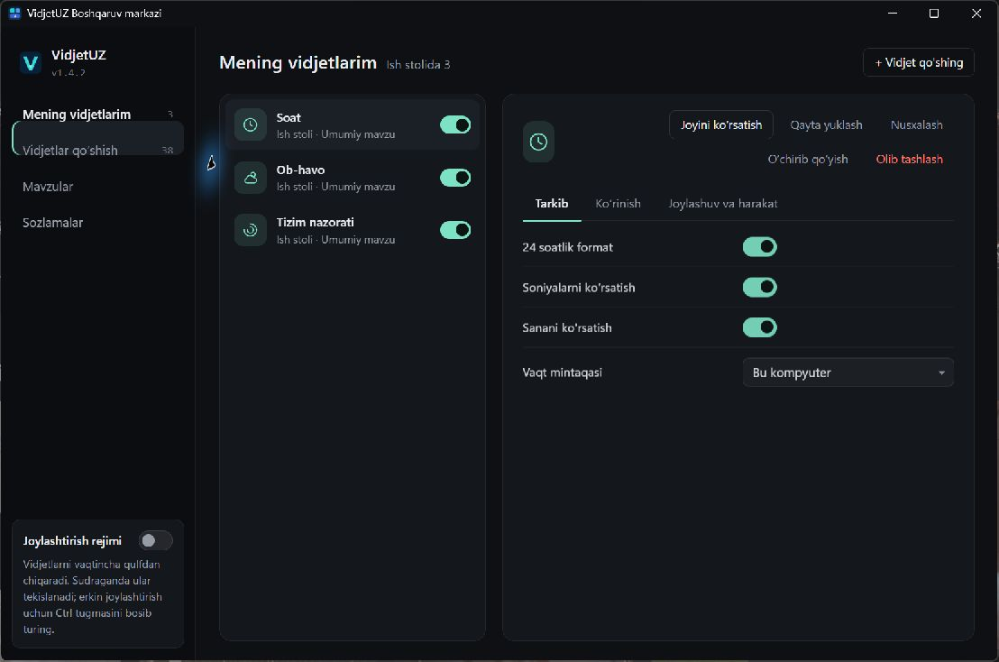
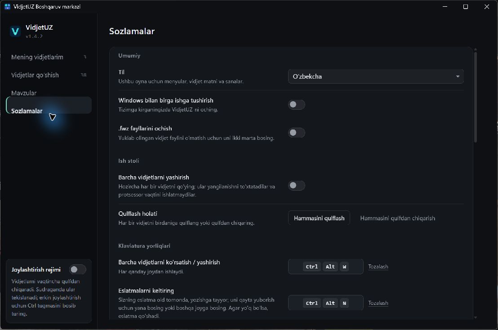

# VidjetUZ

Windows ish stoli uchun o‘zbekcha vidjetlar dasturi. Soat, ob-havo, kalendar, tizim ko‘rsatkichlari, eslatma, vazifalar ro‘yxati va yana ko‘plab vidjetlar bor. Jami **38 ta tayyor vidjet**.

VidjetUZ [FullWidget](https://github.com/hmgvibe/FullWidget) 1.4.1 asosida tayyorlangan mustaqil o‘zbekcha talqin. Nomi va belgisi alohida; ma’lumotlari ham FullWidget jildiga aralashmaydi.

## Ko‘rinish

## O‘rnatish

1. [So‘nggi versiyadan](https://github.com/Kingprogrammer07/VidjetUZ/releases/latest) `VidjetUZ-1.4.2-win-x64-full.zip` faylini yuklab oling.
2. ZIP faylni, masalan, `C:\Users\SIZ\AppData\Local\Programs\VidjetUZ` jildiga chiqaring.
3. Ichidagi `VidjetUZ.exe` faylini oching. Windows 11 kerak; Microsoft Edge WebView2 odatda o‘rnatilgan bo‘ladi.
4. Birinchi ishga tushirishda soat, ob-havo va tizim nazorati vidjetlari paydo bo‘ladi. Boshqaruv markazini ochish uchun pastdagi tizim sohasidagi **V** belgisini bosing.

ZIP tarkibidagi fayllarni birga saqlang. Faqat `VidjetUZ.exe` faylini alohida ko‘chirmang. O‘rnatgichsiz paket barcha kerakli .NET kutubxonalarini o‘z ichiga oladi.

## Qanday foydalaniladi

- **Vidjet qo‘shish:** boshqaruv markazida **Vidjetlar qo‘shish** bo‘limini ochib, kerakli vidjetdagi **Qo‘shish** tugmasini bosing.
- **Joyini o‘zgartirish:** vidjetni sichqoncha bilan sudrang. Tartibli joylashtirish uchun **Joylashtirish rejimi**ni yoqing.
- **Ko‘rinishni sozlash:** **Mening vidjetlarim** bo‘limida vidjetni tanlang, so‘ng **Ko‘rinish** sahifasiga o‘ting. Rang, mavzu va qatlamni shu yerda o‘zgartirasiz.
- **Til:** **Sozlamalar → Til → O‘zbekcha**. O‘zbekcha yangi o‘rnatmada avtomatik tanlanadi.
- **Vaqtincha yashirish:** **Sozlamalar → Barcha vidjetlarni yashirish**. `Ctrl+Alt+W` tugmalari ham shu amalni bajaradi.
- **Avtomatik ishga tushirish:** **Sozlamalar → Windows bilan birga ishga tushirish**.
- **Chiqish:** tizim sohasidagi V belgisini o‘ng tugma bilan bosib, **Chiqish**ni tanlang.

## O‘chirish va ma’lumotlar

1. Dasturdan **Chiqish** orqali chiqing.
2. `VidjetUZ.exe --cleanup` buyrug‘i bilan avtomatik ishga tushirish va `.fwz` bog‘lanishini olib tashlang.
3. Dasturning jildini o‘chiring. Shaxsiy sozlamalar `%AppData%\VidjetUZ`, kesh va jurnal `%LocalAppData%\VidjetUZ` ichida saqlanadi; ularni faqat kerak bo‘lmasa o‘chiring.

FullWidget ma’lumotlari boshqa jildda saqlanadi va VidjetUZ ularni ko‘chirmaydi.

## Dasturchilar uchun

Yangi vidjet yaratish uchun **Vidjetlar qo‘shish → Yangi vidjet**ni oching. O‘zbekcha [boshlang‘ich qo‘llanma](docs/vidjet-qollanma.uz.md) mavjud. Batafsil texnik API hujjati [asl inglizcha qo‘llanmada](docs/widget-guide.en.md) saqlangan.

Papkalarni bitta kartada bir nechta nomlangan bo‘limga ajratish uchun [Papka guruhlari vidjeti](extras/guruhlar/README.md) ham bor. Papkalar faqat yorliq sifatida qo‘shiladi.

## Manba va litsenziya

Dastur kodi [GPL-3.0](LICENSE) asosida. `sdk/` va `templates/` alohida [MIT litsenziyasi](sdk/LICENSE) ostida. Asl muallif va loyiha: [hmgvibe/FullWidget](https://github.com/hmgvibe/FullWidget). [Asl README](README.upstream.md) ham saqlangan. VidjetUZ FullWidget’ning rasmiy versiyasi emas.

Tarjima hamjamiyat uchun ochiq: noto‘g‘ri yoki noqulay iborani topsangiz, issue yoki pull request yuboring. Vidjetlar katalogidagi ayrim namuna rasmlari asl loyihadan olingan va unda xitoycha matn ko‘rinishi mumkin; vidjetning o‘zi va boshqaruv oynasi o‘zbekcha ishlaydi.

Tarjima matnini `sdk/uz.json` ichida tahrirlang, so‘ng `python tools/sync-uz.py` bilan brauzer uchun lug‘atlarni yangilang.
